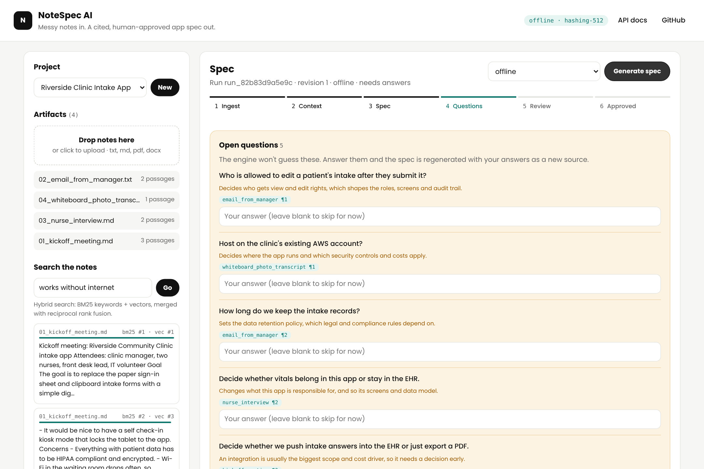
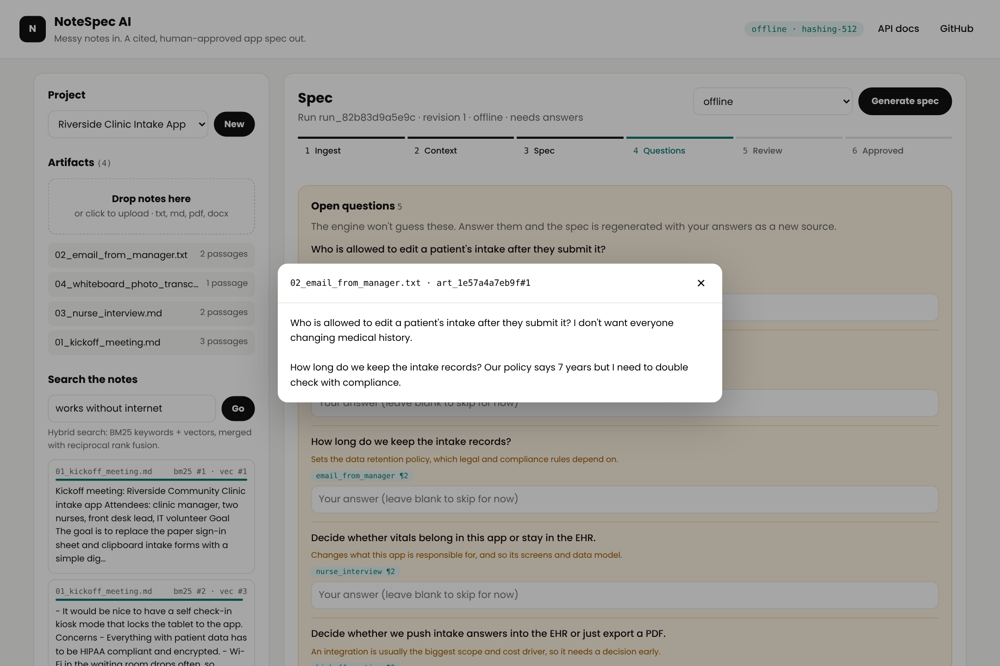
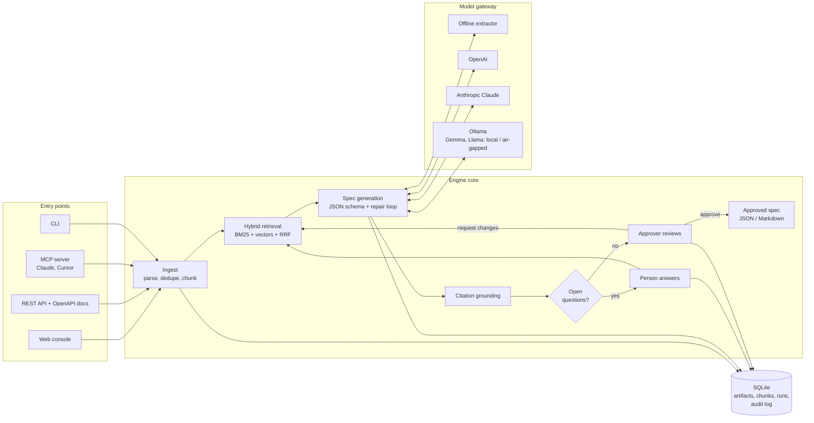
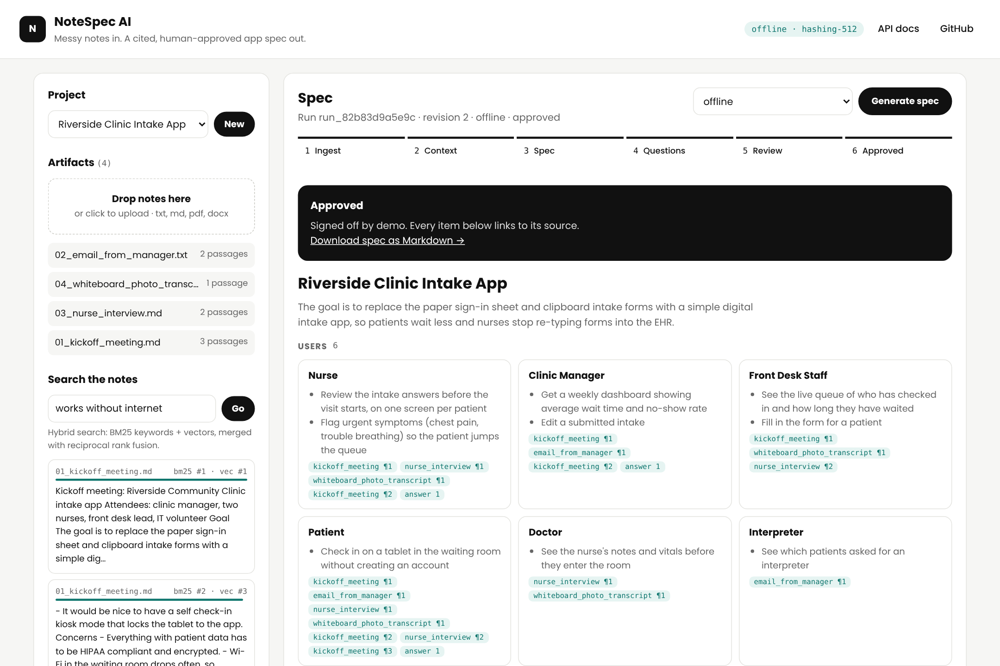

# NoteSpec AI

**Messy project notes in. A cited, human-approved app spec out.**

Meeting notes, emails, interview write-ups and whiteboard photos hold most of what a team knows about the app it wants to build, but nobody turns them into a clear spec. NoteSpec AI ingests those artifacts, retrieves what matters with hybrid search, and drafts a structured spec covering users, features, data entities, screens and constraints. **Every item links back to the passage it came from.** When the notes don't say something, the engine asks an open question instead of guessing, and a human approves the spec before anyone builds from it.

**[▶ Try the live demo](https://dharani-ch3.github.io/notespec-ai/)**: the real Python engine running in your browser on WebAssembly ([Pyodide](https://pyodide.org)). No server, no sign-up, and your notes never leave your device. Click *Load sample clinic notes*, then *Generate spec*.

[](https://github.com/Dharani-ch3/notespec-ai/actions/workflows/ci.yml)
[](https://dharani-ch3.github.io/notespec-ai/)
[](https://render.com/deploy?repo=https://github.com/Dharani-ch3/notespec-ai)



## What it does

| Step | What happens |
|---|---|
| **Ingest** | Upload `.txt`, `.md`, `.pdf`, `.docx`, `.csv` or `.json`. Text is cleaned, de-duplicated by hash, and split into overlapping, paragraph-aware chunks. |
| **Retrieve** | Hybrid search: **BM25** for exact terms ("HIPAA", "SSO") plus **dense vectors** for paraphrases, merged with **Reciprocal Rank Fusion**. The spec's context is built with one retrieval query per spec section. |
| **Generate** | A model drafts the spec as JSON. It's validated against a Pydantic schema; invalid output goes back to the model with the error (a **repair loop**, up to 2 retries). |
| **Ground** | Every citation is checked against the real context. Claims citing passages that don't exist are **dropped and reported** as warnings. |
| **Ask** | Gaps and undecided points become **open questions**. Answers are stored as a new, citable source, and the spec is regenerated. |
| **Approve** | An approver signs off or requests changes. Reviewer notes go back into the context. With auth on, **the person who started a run can't approve it**. |
| **Audit** | Every step (ingest, context built, spec generated, answers, approval) is written to an append-only audit log. |

Click any source chip to see the exact passage behind a claim:



## Architecture



**Design rules**

1. **Models are swappable.** All model calls go through one gateway (`engine/gateway.py`). Switching from OpenAI to Claude to a local Gemma model is an environment variable, not a code change. New providers register in one dictionary.
2. **No claim without a source.** The schema requires sources, the grounding step enforces them, and the UI shows them.
3. **Ask, don't guess.** Missing information (who can access what, where the app runs) becomes a question even when the notes never mention it.
4. **A human signs off.** Specs can't be approved while questions are open, and approval is role-gated.
5. **Runs anywhere.** The default `offline` provider is a deterministic, rule-based extractor with local hashing embeddings: no API keys, no cost, no data leaving the machine. The public demo runs this way.

## How the live demo works

GitHub Pages only serves static files, so the demo brings Python to the browser instead of a server. `scripts/build_site.py` bundles the engine's modules and the sample notes, and the page loads [Pyodide](https://pyodide.org) (CPython compiled to WebAssembly) plus `pydantic` and `sqlite3`. The web console normally calls the REST API; in the demo it calls `engine/bridge.py`, which exposes the same routes as a function. The ingest, retrieval, extraction, grounding and approval code that runs is the same code the server runs. The [`pages.yml`](.github/workflows/pages.yml) workflow runs the tests, rebuilds the demo and republishes it on every push to `main`.

The demo uses the offline extractor. Cloud and local LLM providers need the server (`uvicorn` or Docker below), since API keys don't belong in a browser.

## Quick start

```bash
git clone https://github.com/Dharani-ch3/notespec-ai
cd notespec-ai
python -m venv .venv && source .venv/bin/activate
pip install -r requirements.txt
uvicorn engine.api:app --reload
```

Open http://localhost:8000, click **Load sample clinic notes**, then **Generate spec**. API docs are at `/docs`.

**Use a real model:**

```bash
export ENGINE_PROVIDER=anthropic ANTHROPIC_API_KEY=sk-...     # or openai / OPENAI_API_KEY
export ENGINE_EMBEDDER=openai OPENAI_API_KEY=sk-...           # optional: better semantic search
```

**Fully local with Docker + Ollama** (nothing leaves your machine):

```bash
docker compose up -d
docker compose exec ollama ollama pull gemma3
docker compose exec ollama ollama pull nomic-embed-text
```

**From the command line:**

```bash
python -m engine.cli spec examples/clinic_intake          # prints the spec as Markdown
python -m engine.cli search examples/clinic_intake "works without internet"
```

**As an MCP tool** (Claude Desktop, Cursor):

```json
{
  "mcpServers": {
    "notespec": {
      "command": "python",
      "args": ["-m", "engine.mcp_server"],
      "cwd": "/path/to/notespec-ai"
    }
  }
}
```

Tools: `create_project`, `add_note`, `search_notes`, `generate_spec`, `answer_questions`, `get_spec`, `export_spec`, `list_projects`. Approval stays with a human in the web console.

## API

| Method | Path | Role |
|---|---|---|
| `POST` | `/api/projects` | editor |
| `POST` | `/api/projects/{id}/artifacts` (multipart) · `/artifacts/text` · `/sample` | editor |
| `GET` | `/api/projects/{id}/search?q=` | viewer |
| `POST` | `/api/projects/{id}/runs` | editor |
| `POST` | `/api/runs/{id}/answers` `{"answers": {"Q-1a2b3c": "..."}}` | editor |
| `POST` | `/api/runs/{id}/review` `{"decision": "approve" \| "request_changes", "note": "..."}` | approver |
| `GET` | `/api/runs/{id}` · `/events` · `/export.md` | viewer |
| `GET` | `/api/chunks/{chunk_id}` | viewer |

**Auth:** set `ENGINE_API_KEYS="alice:approver:KEY1,bob:editor:KEY2,carol:viewer:KEY3"` and send `X-API-Key`. With no keys set, the engine runs in open demo mode.

## Configuration

See [`.env.example`](.env.example). Key settings: `ENGINE_PROVIDER` (`offline` | `openai` | `anthropic` | `ollama`), `ENGINE_EMBEDDER` (`hashing` | `openai` | `ollama`), `ENGINE_DB_PATH`, `ENGINE_API_KEYS`.

## Tests

```bash
pip install pytest ruff
pytest -q && ruff check .
```

The 26 tests cover chunking, PDF/DOCX parsing, hybrid ranking, offline extraction, the LLM path (with a fake model that returns invalid JSON first, to exercise the repair loop and citation grounding), provider fallback, the full API flow from upload to approval, role checks, separation of duties, the MCP tools, and the in-browser bridge and site build. CI runs them on Python 3.11 to 3.13 and smoke-tests the Docker image.

## Project layout

```
engine/
  api.py         REST API, auth, web console
  core.py        Engine: ingest, context building, run lifecycle, export
  spec.py        Offline extractor, LLM prompt, repair loop, citation grounding
  index.py       BM25 + vector search with Reciprocal Rank Fusion
  gateway.py     Model gateway: OpenAI, Anthropic, Ollama, embedders
  ingest.py      File parsing and chunking
  store.py       SQLite storage and audit log
  mcp_server.py  MCP tools
  cli.py         Command line
  bridge.py      The API's routes as a function call, for the in-browser demo
  static/        Web console (plain HTML/CSS/JS, no build step)
scripts/build_site.py     Builds the GitHub Pages demo
examples/clinic_intake/   Sample notes from a community clinic project
tests/
```

## Roadmap

- Generate code and tests from an approved spec, with a test-and-fix loop
- Package approved apps as a container + Helm chart behind a deploy-adapter interface (`plan`, `validate`, `deploy`, `status`, `rollback`)
- Postgres + pgvector storage for multi-user deployments
- Retrieval evaluation set (recall@k) for comparing embedders



## License

MIT © Dharani Chalichama
